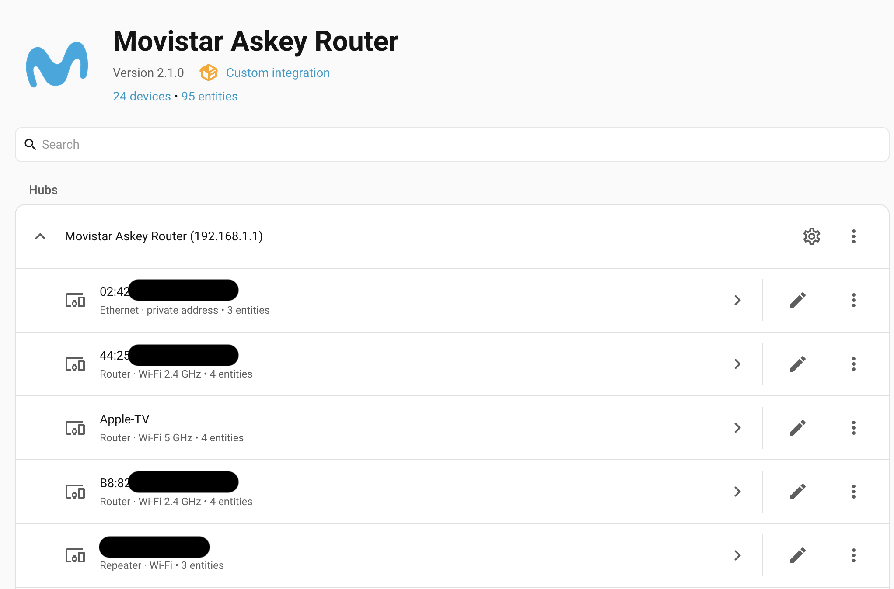
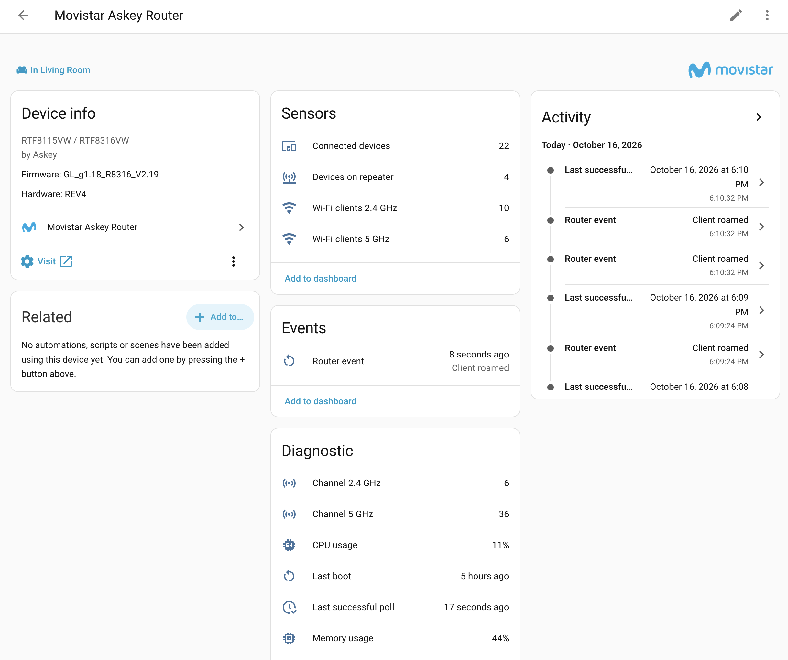

# Movistar Askey Router for Home Assistant

[](https://github.com/andyzasl/ha-movistar-askey/actions/workflows/validate.yaml)
[](https://hacs.xyz/docs/faq/custom_repositories/)
[](https://github.com/andyzasl/ha-movistar-askey/releases)

A modern, local-polling Home Assistant integration for compatible Movistar
Askey routers. It reads the router's local web interface and exposes presence
trackers, per-client Wi-Fi details (band, signal, router or mesh repeater),
router health sensors, and reboot and roaming events—without using a Movistar
cloud service.



This project started as a fork of
[`jardenberg/ha-movistar-askey`](https://github.com/jardenberg/ha-movistar-askey),
itself a modernization of
[`luis-garza/movistar_rft8115vw`](https://github.com/luis-garza/movistar_rft8115vw),
and is now maintained independently under the `movistar_askey` integration domain.

> [!NOTE]
> Tested live with a Movistar RTF8316VW and Home Assistant 2026.7.3 and
> 2026.10.1. Keep a recent Home Assistant backup when upgrading.

## Compatibility

| Router | Status | Notes |
| --- | --- | --- |
| **Askey RTF8316VW** | Live verified | Movistar WiFi 7 Router; hardware revision 4 tested |
| **Askey RTF8115VW** | Expected compatible | Original integration target; uses the same local web-map protocol |
| Other Movistar routers | Unknown | Do not assume compatibility from branding alone |

The integration expects the router's local web interface at an IPv4 address,
normally `192.168.1.1`. It uses the **router web-admin password**, not the Wi-Fi
password.

### Tested firmware

| Model | Hardware | Firmware | Customization | Tested |
| --- | --- | --- | --- | --- |
| Askey RTF8316VW | REV4 | `GL_g1.18_R8316_V2.19` | `TEF-ES` | Device map (including the router/repeater link field), session reuse, XML status endpoints (`cbListWifiAccPtAssociation`, `cbGetWifi`, `cbGetSummary`) |

The mesh setup tested was the router as EasyMesh controller with one MitraStar
repeater (agent) on a wireless backhaul.

Wi-Fi details, router sensors, router/repeater attachment and the events are
verified only on the firmware above. Other firmware may name or nest fields
differently; the related sensors then stay empty while device tracking keeps
working. Router firmware is shown on the router device in Home Assistant;
please include it when reporting results.

## What the integration provides

- Setup, reauthentication and reconfiguration through **Settings → Devices &
  services**
- Local communication directly with the router over HTTP, reusing one web
  session between polls
- A router device with firmware and hardware revision, and a **Mesh repeater**
  device when clients use the repeater
- One device tracker per client MAC address, disabled by default
- Per-client device cards showing where and how the client is connected
- Optional per-client sensors: IP address, Wi-Fi signal and person
- Router sensors: connected devices, Wi-Fi clients per band and on the
  repeater, channels, CPU, memory, last boot, reachability
- Events for router reboots and client roaming
- A repair notice when the router stays unreachable
- Configurable polling, presence grace period and client sensors
- Diagnostics without credentials, client names, IP addresses or MAC addresses
- English and Spanish text

### Entities

#### Connected devices sensor

The enabled-by-default sensor reports the number of devices in the latest
successful router poll. Its `devices` attribute contains the current name, IPv4
address, and MAC address reported for each client.

The exact entity ID is assigned by Home Assistant. A typical dashboard card is:

```yaml
type: entities
title: Local network
entities:
  - entity: sensor.movistar_askey_router_connected_devices
    name: Connected devices
```

#### Device trackers

The integration creates a tracker entity when it first observes a client MAC address.
Trackers are **enabled by default** for network presence tracking and can immediately
be assigned to a person in **Settings → People → [Person Name] → Track device**.

If there are devices you do not wish to track (such as smart plugs or IoT gadgets),
you can disable them at any time:

1. Open **Settings → Devices & services → Movistar Askey Router → Entities** (or navigate to the device card).
2. Select the relevant device tracker entity.
3. Toggle **Enable entity** off in the entity settings and click **Update**.

Each tracker exposes the latest hostname, IPv4 address, and MAC address. A
client remains `home` for the configured presence-grace period after it stops
appearing in the router map.

Trackers also expose `connection` (`wifi` or `ethernet`), `node` (`router` or
`repeater`), `access_point`, `private_mac` and `person`. For clients associated
directly with the router's Wi-Fi, they add `band`, `ap_id`, `rssi` (dBm),
`link_rate`, `wifi_standard` and `associated_seconds`. Clients behind the mesh
repeater are not in the router's association table, so they have no band or
RSSI.

A device with a private (randomized) Wi-Fi address can appear as a new device
when the address changes. For devices assigned to a person, set the private
Wi-Fi address on the device to **Fixed** for this network.

#### Client devices

Each client's device card shows where it is connected:

- **Connected via** points to the router or to the **Mesh repeater** device.
- The model line shows where and how, for example `Router · Wi-Fi 5 GHz ·
  private address`, `Repeater · Wi-Fi` or `Ethernet`. *Private address* means
  the device uses a randomized Wi-Fi MAC.

Both are updated on every poll (see the screenshot at the top). Duplicated
names, common for Apple devices, get a MAC suffix such as `iPhone (81:7E)`;
renaming a device in Home Assistant overrides it.

#### Router sensors



| Sensor | Notes |
| --- | --- |
| Wi-Fi clients 2.4 GHz / 5 GHz | Clients associated directly with the router; mesh backhaul links are excluded |
| Devices on repeater | Clients attached to the mesh repeater (may include the repeater itself) |
| Client roams | Total roams of all clients since installation; survives restarts |
| Last boot | Diagnostic; derived from router uptime |
| CPU usage, Memory usage | Diagnostic; percent |
| Channel 2.4 GHz / 5 GHz | Diagnostic; `bandwidth_mhz` attribute |
| Last successful poll | Diagnostic; `consecutive_failures` attribute |
| Router reachable | Diagnostic binary sensor; `off` while polls fail |

The router device shows the firmware and hardware revision. These values come
from the router's XML status endpoints, verified on the RTF8316VW. On routers
without these endpoints the sensors stay empty and device tracking is not
affected.

#### Client sensors

Each client gets an **IP address**, a **Person** (the persons using its
tracker) and a **Roams** sensor, and each client seen on the router's Wi-Fi
also gets a **Wi-Fi signal** sensor (dBm). All are attached to the client
device. The **Client sensors** option controls whether they are enabled:

| Mode | Behavior |
| --- | --- |
| Manual (default) | Created disabled; enable the ones you want |
| Follow tracker | A client's sensors are enabled while its device tracker is enabled |
| All | Every client's sensors are enabled |

Sensors you disabled yourself are never re-enabled. After a sensor is enabled,
Home Assistant reloads the integration about 30 seconds later to activate it.
The signal value is empty while the client is away or connected through the
mesh repeater.

#### Events

- The **Router event** entity records `rebooted` when router uptime goes
  backwards between two polls (bus event `movistar_askey_router_rebooted`
  with `uptime_seconds` and `previous_uptime_seconds`).
- Client roaming fires the `movistar_askey_client_roamed` bus event when a
  client present in two consecutive polls changes node (router ⇄ repeater) or
  band (with `mac`, `name`, `device_id`, `from_node`, `to_node`, `from_band`,
  `to_band`, `message` and `roam_count`).

The logbook names the client, for example `iPhone (F0:06) roamed router 5 GHz →
repeater`, and the entry also appears in that client's device **Activity**.
Roams are counted per client (**Roams** sensor) and in total (**Client roams**
on the router). Both counters survive restarts; use Home Assistant statistics
or a utility meter for roams per hour or day.

Example: notify when a client moves between router and repeater.

```yaml
triggers:
  - trigger: event
    event_type: movistar_askey_client_roamed
conditions:
  - condition: template
    value_template: "{{ trigger.event.data.from_node != trigger.event.data.to_node }}"
actions:
  - action: notify.notify
    data:
      message: >-
        {{ trigger.event.data.name }} moved from
        {{ trigger.event.data.from_node }} to {{ trigger.event.data.to_node }}
```

Roams are detected between polls, so a short polling interval (for example 60
seconds) catches more of them; transitions faster than the interval are not
seen.

#### Repairs

After three consecutive failed polls, a notice appears under **Settings →
Repairs**. It clears automatically after the next successful poll.

## Installation with HACS

Install it as a custom HACS repository:

1. Open **HACS → Integrations**.
2. Open the menu and choose **Custom repositories**.
3. Add `https://github.com/andyzasl/ha-movistar-askey` with category
   **Integration**.
4. Open **Movistar Askey Router** in HACS.
5. Install the latest version.
6. Restart Home Assistant.

Then configure the router:

1. Open **Settings → Devices & services**.
2. Select **Add integration**.
3. Search for **Movistar Askey Router**.
4. Enter the router IP address and its web-admin password.

No username is required by the supported router interface.

## Migration Guide

Because this integration now runs under its own unique domain (`movistar_askey`), it installs into `custom_components/movistar_askey` and does not conflict with or overwrite `custom_components/movistar_rft8115vw`.

### Migrating from `luis-garza/movistar_rft8115vw`

If you are currently using the upstream `luis-garza/movistar_rft8115vw` integration (from HACS default or manual install):

1. **Remove the old integration**:
   - In Home Assistant, open **Settings → Devices & services**.
   - Find the existing **Movistar RFT8115VW** (or `movistar_rft8115vw`) integration entry, click **⋮ → Delete**.
2. **Remove the old repository in HACS**:
   - In **HACS → Integrations**, find `luis-garza/movistar_rft8115vw` and choose **Remove**.
3. **Remove legacy YAML configuration** (if applicable):
   - If you still have a legacy YAML tracker block in `configuration.yaml`:
     ```yaml
     device_tracker:
       - platform: movistar_rft8115vw
         host: 192.168.1.1
         password: !secret movistar_router_password
     ```
     remove that block and check your Home Assistant configuration.
4. **Install Movistar Askey Router**:
   - In HACS, search for **Movistar Askey Router** (version 3.0.0+) and install it.
   - Restart Home Assistant.
5. **Add the new integration**:
   - Go to **Settings → Devices & services → Add integration**, search for **Movistar Askey Router**, and enter your router's IP address (usually `192.168.1.1`) and admin password.
   - Enable only the device trackers or client sensors used by your automations.

### Migrating from version 2.x of this repository

If you previously installed version 2.x of `andyzasl/ha-movistar-askey` as a custom repository:

1. **Remove the 2.x integration entry**:
   - In Home Assistant, open **Settings → Devices & services** and delete the previous **Movistar Askey Router** entry (which was registered under the old domain `movistar_rft8115vw`).
2. **Update in HACS**:
   - In **HACS → Integrations**, update `andyzasl/ha-movistar-askey` to version 3.0.0 or later.
   - Restart Home Assistant.
3. **Re-add the integration**:
   - Go to **Settings → Devices & services → Add integration**, search for **Movistar Askey Router**, and enter your router credentials.
4. **Update event automations**:
   - If you have automations listening to bus events, update the event types:
     - `movistar_rft8115vw_client_roamed` ➔ `movistar_askey_client_roamed`
     - `movistar_rft8115vw_router_rebooted` ➔ `movistar_askey_router_rebooted`

## Options

Open **Settings → Devices & services → Movistar Askey Router**. On the entry
row, select the gear icon (or **⋮ → Options**, depending on the Home Assistant
version).

| Option | Default | Allowed range | Purpose |
| --- | ---: | ---: | --- |
| Polling interval | 300 seconds | 30–3600 seconds | How often the router is polled |
| Presence grace period | 600 seconds | 0–3600 seconds | How long a missing client remains `home` |
| Client sensors | Manual | Manual, Follow tracker, All | Which per-client IP address, Wi-Fi signal, person and roam sensors are enabled |

Internally, the effective presence grace period is never shorter than the
polling interval. Saving options reloads the integration once.

To change the router address or password, use **⋮ → Reconfigure** on the same
entry row. Existing entities are kept.

## Troubleshooting

### The router rejects the password

- Confirm that the same password works at `http://192.168.1.1`.
- Use the **router administration** password, not the Wi-Fi password.
- Confirm that the router model is compatible.
- If a setup attempt was interrupted, close the dialog, wait briefly, refresh
  **Devices & services**, and try again.

Version `2.0.0-beta.3` includes the RTF8316VW authentication fix and registers
the parent router before client trackers, satisfying Home Assistant's strict
device-registry ordering requirements.

Version `2.0.0-beta.2` fixed a false authentication failure on the RTF8316VW:
its authenticated network-map page still references the login endpoint.

### The integration is unavailable after restart

The router must be reachable from Home Assistant. Verify the configured IP and
that Home Assistant is on the same routed local network. Startup connection
failures are retried by Home Assistant.

### Short router outages

A failed poll is treated as a gap in data collection, not as clients leaving.
Entities stay available for up to two consecutive failed polls; trackers keep
their state for the presence grace period after their last successful
observation. After the third consecutive failure the entities become
unavailable and a repair notice appears. The diagnostic **Last successful
poll** sensor, its `consecutive_failures` attribute and the **Router
reachable** sensor show the current state.

The integration keeps its router web session between polls. Logging in to the
router web interface from a browser can still end that session; the
integration then logs in again on the next poll.

When the integration reloads (after an update, an options change, or enabling
entities), its trackers are `unavailable` for a few seconds. Person and zone
automations should treat `unavailable` as unknown, not as away.

### A client tracker is missing

The router must report the client at least once before its tracker can be
created. After the next successful poll, find disabled entities under
**Settings → Devices & services → Entities**.

### Logs and diagnostics

- Logs: **Settings → System → Logs**
- Diagnostics: open the integration entry menu and choose **Download
  diagnostics**

Diagnostics include availability, timing options, failure counts, Wi-Fi client
counts per band and per node, radio settings and the router summary (model,
firmware, uptime, CPU, memory). They do not include credentials or any client
names, IP addresses or MAC addresses.

To support other router models and firmware, diagnostics also describe the
last response of every router endpoint the integration uses: HTTP status,
transport errors, XML element paths, field names, the router `Result` code,
enum values (for example channel, bandwidth, Wi-Fi standard, firmware
identity) and the *shape* of other values (digits become `9`, letters `a`).
The device map is described per column (row lengths, value counts for enum
columns). A cross-table compares the device map's link field with the router's
association table, and the login response shows its cookie names. Identifying
fields (MAC and IP addresses, SSIDs, host names, serial numbers) are always
reported as `redacted`. When opening an issue about an unsupported model,
attach a diagnostics download.

### Person sensor or Related view shows no person

A person is linked to a tracker *entity*, not to a device, so the device page's
**Related** card does not list persons. Open the tracker entity and choose
**Related**, or enable the client's **Person** sensor. Persons must use this
integration's tracker (**Settings → People → [person] → Track device**).

## Privacy and security

- Communication stays on the local network.
- The integration does not call Movistar cloud APIs.
- The router admin password is stored by Home Assistant as config-entry data.
- Home Assistant backups may contain config-entry credentials; protect and
  encrypt backups accordingly.
- Client names, IP addresses, and MAC addresses are intentionally removed from
  downloaded diagnostics.

The router's local web interface uses HTTP rather than HTTPS. Keep Home
Assistant and the router on a trusted LAN.

## Development

The validation workflow runs Ruff, pytest, Home Assistant hassfest, and HACS
validation.

```bash
python -m pip install -r requirements.txt
python -m ruff check .
python -m ruff format . --check
python -m pytest
```

The router parser has no cloud dependency. When changing authentication logic,
add a regression fixture that reflects the HTML returned by the relevant router
firmware without committing passwords or a real client inventory.

### Branches

- `main` holds released, stable code only.
- `dev` is the development branch. Changes go to `dev` (directly or through
  pull requests), and reach `main` through a pull request once validation
  passes.
- HACS installs releases, not branches, so users only receive code that was
  merged to `main` and released.

### Releases

Releases are automatic. On every push to `main`, the release workflow runs the
full validation, reads `version` from `manifest.json`, and, if that version has
no release yet, creates the tag on the merged commit and publishes the GitHub
release with the matching `## <version>` section of
[CHANGELOG.md](CHANGELOG.md) as its notes. Versions containing `-` (for
example `2.3.0-beta.1`) are published as pre-releases. Merges without a version
bump do not create a release.

Release steps:

1. On `dev`: bump `version` in `manifest.json` and add the `## <version>`
   section to `CHANGELOG.md`.
2. Open a pull request from `dev` to `main`; merge it when the **Validate**
   checks pass. The release is published automatically.

## Release status

See [CHANGELOG.md](CHANGELOG.md) for version history and
[GitHub Releases](https://github.com/andyzasl/ha-movistar-askey/releases) for
installable packages. HACS shows the release notes in the update dialog. To
install pre-releases, enable **Show beta versions** on the integration in HACS.

## License and attribution

Licensed under GPL-3.0, following the upstream projects. The original
integration concept and parser are credited to
[luis-garza](https://github.com/luis-garza/movistar_rft8115vw); the version 2
config-entry modernization to
[jardenberg](https://github.com/jardenberg/ha-movistar-askey).

Thank you!
